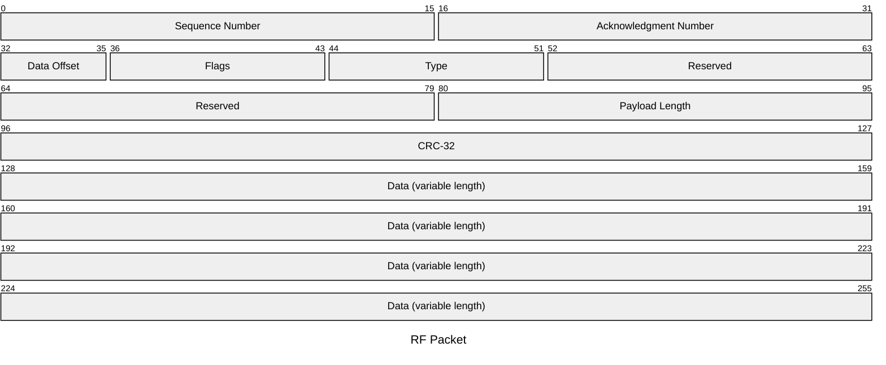
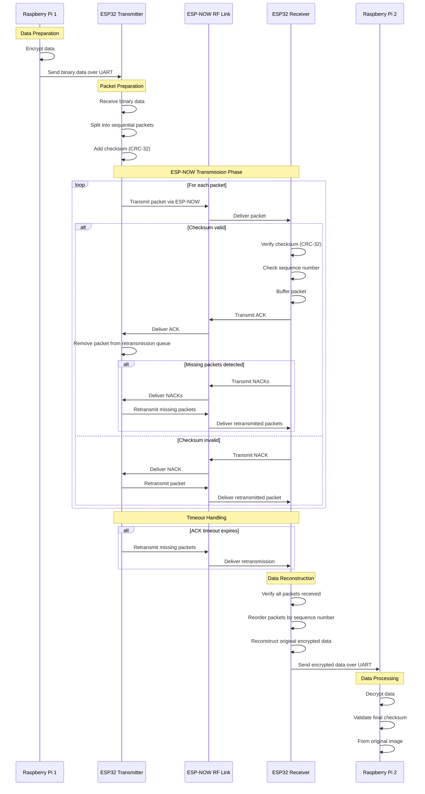

# Radio Communication Protocol (RCP)

The RCP is designed to operate on the Raspberry Pi 4B and interact with the ESP-32 over UART, using ESP-NOW to perform the radio communication.

## Packet Design

The RCP uses a structured packet format to perform reliable data transmission between devices. Each packet contains a standardized header followed by a variable-length data field.

The packet format is outlined below:

The section marked reserved is designed to allow future design implementations.

## RF Link Analysis

The following sequence illustrates the transmission and reception process. The transmitter splits the payload into packets and generates header information, including but not limited to the sequence number and  checksum.

**Note**: Some logic may need to be refined when we actually implement this.

